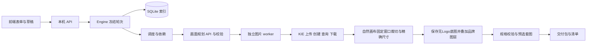
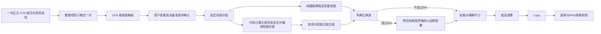

# 技术架构

本应用在用户本机运行。Python 标准库 HTTP 服务提供 API 和静态网页；原生 JavaScript 维护页面状态。SQLite 保存业务索引，图片、供应商回执和交付包保存在文件系统。无需前端打包服务或外部数据库。

## 启动与部署边界

`启动.command` / `启动.bat` → `bootstrap.py` → 项目虚拟环境 → `run.py` → `local_app.server.main()`。启动器准备 Python 依赖；运行入口绑定本机回环地址。服务端使用 `InstanceLock` 防止同一状态目录被重复恢复和调度。

`Settings` 读取本机 `.env` 及环境变量，包含供应商连接、模式、模型和工作区。设置接口仅返回是否配置等公开状态。UI 配置或测试连接与图片任务提交是不同动作。

新安装沿用内部规划网关、`gpt-6.1-terra`、KIE接口和当前`GPT Image 2.6 Flare`图片模型，已有`.env`中的显式网关和模型继续优先。运行入口只检查Pillow，不再依赖已移除的OpenCV/NumPy；发布范围与干净安装验证见[源码发布](releasing.md)。

## 模块分工

| 层 | 入口 | 职责 |
|---|---|---|
| 前端 | `frontend/index.html`、`frontend/js/` | 表单、自动保存草稿、任务轮询、预选、提示词编辑、设置与维护 |
| API | `local_app/server.py` | JSON 请求校验、本机路由、注册素材和图片文件响应 |
| 应用协调 | `local_app/engine.py` | 任务创建、版本、恢复、执行门禁，组合各 Mixin |
| 状态 | `state.py`、`workbench.py` | 草稿/产品资料、冻结快照、任务摘要与按需详情、人工提示词草稿 |
| 队列 | `scheduler.py` | 规划和图片任务入队、依赖、暂停、轮转与限流状态 |
| 画面规划 | `scene_planner.py`、`planning.py` | 网关请求、结构校验、原有提示词规则编译、轮次配置与素材冻结 |
| 图片执行 | `worker.py`、`kie_client.py`、`scripts/render.py` | 独立 worker、上传/创建/查询/下载、回执、请求指纹和恢复 |
| 成品与交付 | `quality.py`、`delivery.py`、`brand_logo.py` | 文件规格与哈希、无Logo底图/独立品牌图层、整套资格、选择快照、ZIP 清单与版本 |
| 数据维护 | `maintenance.py`、`safety.py`、`instance.py` | 备份恢复、清理、磁盘检查及进程锁 |
| 共享图像与素材 | `scripts/`、`assets/`、`config/` | 比例模型注册表、构图/字体/品牌素材、裁切压缩及固定规格 |

前端按 `index.html` 的脚本顺序加载，共享 `S` 等页面状态与函数。目前没有 ES module 或前端框架；测试应加载真实脚本入口，避免只复制被测函数片段。

## 后台页面与只读聚合

`workspace.js`提供固定导航、任务/草稿列表、全局图包、设置和维护；`production.js`将学习机/共用母版详情分阶段展示，并统一普通图片详情。入口仍为原生脚本按index加载，没有构建依赖。

常用图片动作在卡片、进度行和详情中直接展示。学习机卡片/详情复用`production.js`动作函数，仍调用原有单张、背景、Logo或母版接口；普通卡片由`app.js`的`repeatOrdinaryImage`处理提交锁与当前版本校验，并调用既有regenerate/resume接口。展示和页签切换不触发模型，重出范围及冻结规则不在前端重新定义。

`local_app/workspace.py`按来源类型和ID聚合现有Engine任务/草稿及LearningRuntime记录，执行跨来源筛选和绑定查询的分页。图包详情直接读取冻结ZIP，使用有界文件身份缓存避免每张缩略图反复完整校验；成员图片继续验SHA和编码，正式下载仍走原接口。

任务/交付列表在前端按每页10条管理游标历史；上一页、下一页与轮询共用当前页状态。`logo_templates.py`在现有SQLite文档管理普通渠道模板，学习机仍由`learning_logo.py`管理；统一Logo编辑器按类型切换数据源，不将普通版位写入学习机目录。普通轮次冻结模板快照，后叠与图包仍走`brand_logo.py`；配置编辑不直接重画或覆盖图片。

这些接口只读，不创建第三套执行、选择或交付状态。启动默认任务中心；全局页面优先解析自己的URL，不被旧任务参数带回详情。具体页面、模式、图片编辑和验证边界见[后台UI合同](workspace-ui.md)。

## 普通任务调用链

应用商店与信息流沿用原有单/双/三图模型。双/三图的分支引用本套本版位首图，供应商请求按轮次冻结模型和素材。普通任务的模拟模式只模拟图片阶段，画面规划仍可能调用所配置的语言模型；自动测试额外注入离线规划 fixture。

新普通轮次的Logo在本机叠加，模型不接收Logo素材；无Logo底图和两款注册素材随版本冻结。图包可选择另一款Logo并记录实际文件、Logo和来源指纹，当前候选图片及旧包保持不变。旧烘焙Logo图片不能被伪装成可替换图层。具体规则与接口见[Logo图层](logo-layers.md)。

新普通轮次通过`natural_canvas.py`复用学习机共用画布的单目标原生比例、安全区和固定裁切。模型画完整自然场景，每张仍一次生成；不创建蓝框素材或调用框线检测。当前比例的构图要求进入提示词，精确像素和Logo留在本机处理；新轮次冻结协议，退役旧流程拒绝执行，已有文件保留。普通无框协议与学习机草稿v3的执行边界见[无框自然画布](natural-canvas.md)。

普通计划的`framing_rule_version=2`将同一主视觉范围经`scene_planner.plan_input.framing_rule`提前提供给画面规划，再由原有编译器写入图片提示词，减少规划出贴边大特写的情况；不新增模型阶段。旧计划继续生成其原固定规则文本，已提交请求的指纹不变。真实付费样本与视觉限制记录在无框自然画布文档中。

任务状态与交付状态分离。停止不意味着已经提交的供应商任务被撤销；状态不明且已有任务号时优先查询，不能当作从未提交而重做。网络、图片处理、打包等长操作使用已有分阶段快照和锁，不长时间占用全局状态锁。

## 学习机独立分支

配置预览保持离线；独立 `/api/learning-machine/runs` 已接入基准图规划/制作、用户确认、母版分组、单张重出和PNG图包。默认simulation全程本机演练；real必须明确选择且具有有效Key。学习机经普通 `/api/tasks` 或旧上传母图入口的提交会被拒绝；应用商店与信息流继续使用普通任务接口。

上图为专用制作入口的实际顺序；自动化验收使用模拟和本机HTTP桩，首轮真实套图的视觉偏差见学习机提示词合同。已实现模块：

| 模块 | 责任 |
|---|---|
| `learning_runtime.py` | 持久化批次、明确确认、共享池编排、版本、恢复与图包 |
| `learning_runtime_support.py` | 完整规格/规则/素材冻结、服务端场景填值、恢复路径适配 |
| `learning_executor.py` | 本机演练、真实规划/图片服务边界、账户上传缓存与回执 |
| `work_dispatch.py` | 有限全局图片配额、批次轮转、公平FIFO准入和取消 |
| `learning_pipeline.py` | 配置归一化、一次随机、基准图/确认门/输出计划 |
| `learning_setup.py` | 上传参考校验、配置保存、Logo/遮罩快照、离线计划汇总 |
| `learning_prompts.py` | 固定模板、白名单文案、参考用途、共同安全区、单张重出模板 |
| `learning_sizing.py` | 冻结尺寸策略、历史保全适配与本机精确像素导出；自然背景由独立节点完成 |
| `learning_background.py` | 冻结自然背景计划、目标构图草稿、图片模型输入与结果精确裁切；占位草稿不作为成品 |
| `learning_logo.py` | 注册黑/白素材、各版位位置大小、修订冲突与冻结合成 |
| `learning_mask.py` | 审核和导出同源的底部灰色渐变配置 |
| `learning_output.py` | 尺寸→遮罩→Logo→圆角的独立新导出链 |

规则权威来源为内容规则、母版分组、Logo/遮罩配置。`learning-machine-source.json` 保留原表证据；`learning-machine-workflow.json` 和旧 source/adaptation/delivery helper 保留历史格式兼容，不能作为当前新任务的业务规则。当前约定和数量推导见[固定提示词合同](learning-machine-prompts.md)，避免在架构文档再维护一套清单。

## 多尺寸共用母版入口

普通已完成图片/完整套图、学习机已确认基准/成品可显式创建`shared_canvas_adaptation`批次。`master_canvas_support.py`冻结来源字节、任务文案及现行规格；`master_canvas.py`按内容、剧情序号和方向分组，选择注册模型比例、共同保留区及各目标裁框。创建不调用模型；用户启动后每组通过`LearningRuntime`和共享图片池生成一张完整自然画布，再本机裁成精确尺寸。普通输出JPEG，学习机输出PNG，共用原有图层、版本及交付校验。

该入口不依赖普通蓝框检测，也不逐输出追加条件背景调用。`learning_executor.py`校验`shared_canvas_master`的构图草稿/来源图顺序；结果整张画布应延续自然场景，不能把有接缝的占位草稿当作成品。整组重试一次调用更新组内全部输出，状态不明沿原键查询。来源、旧版本和旧ZIP保留。接口、分组边界与视觉验证见[共用母版合同](shared-master-canvases.md)。

## 持久化与版本

- `index.sqlite3` 使用 WAL，保存任务 JSON、documents（草稿、产品资料、配置等）及隔离的异常记录。任务与文档的修订用于并发和增量读取。
- 原始图片、处理后成品、供应商任务状态、工作区和 ZIP 分开保存。旧内部字段 `jpeg` 在历史兼容对象中也可能指向 PNG，以实际冻结格式和文件校验为准。
- 来源版本及 SHA-256、请求模型及指纹、采纳版本和图包清单共同确定恢复与复用。重新生成不覆盖已有交付包。
- 学习机PNG图包以冻结渠道/版位与尺寸形成内部目录，清单保留实际成员路径。`channel-placement-v1`及路径参与图包身份，旧平铺包保持字节和下载地址；再次保存才创建分目录新包。默认、换Logo和学习机共用母版输出共用这条打包逻辑，不调用模型。
- 学习机制作批次冻结完整内容、尺寸/KB/圆角、母版组、视觉、模型与素材副本。导出使用该批次placement_snapshot和图层快照；当前目录修改不回写旧规格。实际请求prompt、参考绑定、供应商原始图片与回执按版本保存。
- 确认后的新母版只引用基准整景及可选真实UI/字体，不重传原始角色、画风海报或构图图。新输出的保全原图尺寸策略冻结在compiled.outputs中，处理结果保留适配方法和裁补比例；旧批次不升级算法或覆盖文件。
- `compiled.framing_node`与各母版`main_visual_framing`保存按全组保留框/遮罩计算的主视觉范围；模板编译时计算，执行时按冻结版本引用。基准图、分组图与单张重出共用构图函数，不额外调用模型；完整性审核为用户查看，不伪装为自动语义检测。
- 自然背景节点在母版后按比例差分支：不超过8%轻裁，超过8%以构图草稿和原始无Logo图进行图生图，再裁出精确目标。新批次自动执行；旧批次用`repair-backgrounds`显式新增输出版本。背景任务按来源SHA、目标比例和文字复用，未知状态沿冻结回执恢复；`force_ai`明确重试以新操作建立独立任务。Logo更新和导出换款复用适配后的无Logo图，不再次生图。
- `POST /api/learning-machine/runs/{id}/from-baseline` 从已确认且空闲的批次创建新规则批次，复制基准图和素材字节、继承同哈希的确认并记录来源，不修改源批次或自动扩套。新批次重新构图所有母版（含原可直接复用的B1），正常`expand`才调用图片模型；幂等签名包含来源和版位，复制后再校验源revision与确认。旧模板的请求指纹保持不变。
- 图片模型的最小上下文、v2基准模板和各节点职责见[模型上下文合同](learning-image-context.md)。内部规则/版本/图层参数不转发给图片模型。
- 已存在的普通/旧学习机任务使用当时保存的完整轮次规格。恢复测试应读取已有冻结数据，不能从当前目录重建所谓旧规格。

旧学习机轮次即使重启恢复为规划排队，也在规划器调用之前执行入口门禁；保持记录可读，不重新调用已关闭的旧规划流程。已有图片回执的恢复查询继续保留。

## 并发、背压与锁

- 规划通过共享planning_pool，单并发；编排线程在池外等待，不占图片worker。
- 普通与学习机图片任务共用FairImagePool，上限20、等待容量512；每批次FIFO、批次间轮转，现有远端请求不抢占。运行数由真实开始执行的Future计，排队状态独立。
- 每批次的15个新母版可并行，B1直接复用首图；本机导出通过共用4槽Semaphore，避免大图压缩一起占满资源。活动学习机批次上限8，超额不消费幂等键或启动新线程。
- 429的明确未接受请求与未知提交区分；前者触发共享短退避、并发减半和后续渐进恢复，未知状态保持原任务号与指纹，仅查询，不盲重交。
- 网络、图片哈希与重型导出在状态锁外；详情revision相同只返轻量队列摘要；列表低频、隐藏页降频。素材缓存由内容哈希与账户/上传端点隔离，跨学习机批次共用，文件锁避免并行重复上传。
- 批次去掉重复计划/快照别名，版本审计仍保留，减少SQLite反复写入。

## 验证与文档维护

测试选择和替身边界见[测试说明](testing.md)；业务术语见根目录 `CONTEXT.md`。增加新接口或改变状态边界时同步此文档；增加渠道或修改尺寸时更新对应配置和用户说明，避免复制数值清单。
